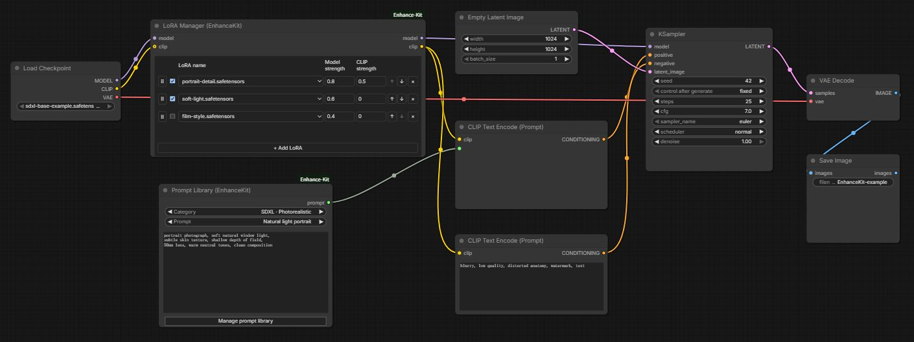
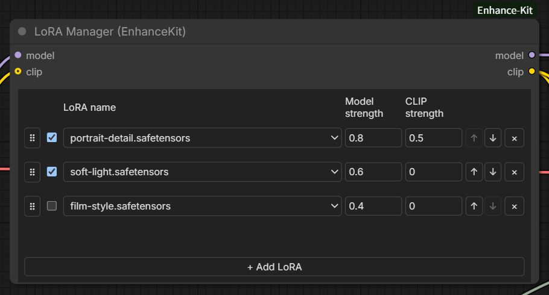
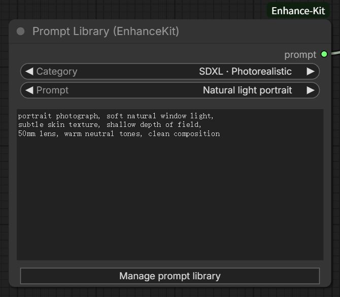
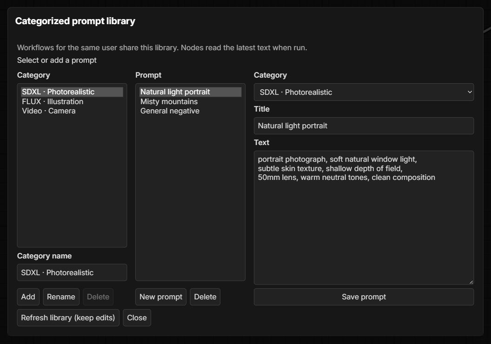
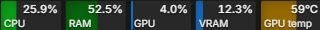

# ComfyUI-Enhance-Kit

[简体中文](README.md) | **English**

## English

A lightweight utility extension for ComfyUI with a **LoRA manager**, a **categorized prompt library**, and **menu bar resource monitoring**. Combine multiple LoRAs in one node, maintain reusable prompts across workflows, and monitor host resources. No models are bundled with the extension.

The interface supports Simplified Chinese and English and follows the language selected in ComfyUI. Saved category names, prompt titles and text, and LoRA file names retain their original content.

### Workflow example



Connect the prompt library to a CLIP text encoding node, and route the model and CLIP through the LoRA manager to the sampler and text encoding nodes. File names and prompts are illustrative; supply your own compatible models and LoRAs.

### Features

#### LoRA manager

Search for **LoRA Manager (EnhanceKit)**, or add the node from `EnhanceKit → Model`.



1. Connect the loader's `MODEL` output to the node's `model` input, then connect its `model` output to your sampler.
2. Click **Add LoRA**, select a file, and set its model and CLIP strengths. The defaults are `1` and `0`. Add more entries as needed; the same file can be selected multiple times.
3. Use the checkbox to enable or disable an entry, and `×` to remove it. Drag the handle on the left to reorder entries, or use the up and down arrows.
4. To apply text encoder patches, connect the loader's `CLIP` output to the node's `clip` input. Connect the node's `clip` output to the text encoding nodes for your positive and negative prompts, and adjust the relevant LoRA's CLIP strength.

Enabled entries are applied from top to bottom. Both strengths support negative values. Disabled entries and entries with both strengths set to `0` do not read their files. A part with zero strength retains its original object. An empty list, or a list with all entries skipped, returns the original model and the connected CLIP. Removing an entry does not delete the LoRA file from disk.

- **CLIP input is optional**: its default strength is `0`, so existing MODEL-only workflows continue to work. Old entries without a CLIP strength are restored with `0`. An enabled entry with a nonzero CLIP strength requires a connected CLIP input; execution reports an error if it is missing.
- Set model strength to `0` and CLIP strength to a nonzero value to apply only text encoder patches. Whether a LoRA includes these weights depends on how it was trained and saved.
- Files are selected from ComfyUI's LoRA directories, usually `models/loras`. LoRA directories configured in `extra_model_paths.yaml` are also supported. Refresh node definitions after adding files; restart ComfyUI and refresh the browser if needed.
- File selections, enabled states, strengths, and ordering are saved with the workflow. **Workflows do not contain LoRA files**. Copy the files separately when migrating, and preserve their relative paths.
- Unavailable files retain their selections and display a message. An enabled entry with a nonzero strength must be assigned a valid file or disabled, otherwise execution fails.

Ordinary LoRAs add fixed weight deltas, so changing their order usually does not change the mathematical result, although floating-point calculations may differ slightly. Patches such as DoRA that depend on current weights may be affected by ordering. This node uses ComfyUI's official loading and patching mechanisms; compatibility depends on the base model and selected LoRAs.

#### Categorized prompt library

Search for **Prompt Library (EnhanceKit)**, or add the node from `EnhanceKit → Prompt`.



1. Click **Manage prompt library** and create a category.
2. Create a prompt, enter its title and text, and save it. Organize categories by model, task, or your own preferences.
3. Select a category and prompt title in the node. Connect its `prompt` output to a text input that accepts `STRING`, such as the text input of a CLIP text encoding node.



The node uses standard dropdowns, a read-only text preview, and buttons. Workflows belonging to the same ComfyUI user share a prompt library; separate user profiles maintain separate libraries. Category names are unique within a library, and prompt titles are unique within a category. Different categories may use the same title.

- Runs submitted from the UI read the latest prompt text from the library. Once queued, that run uses a fixed snapshot.
- Renaming or moving a prompt preserves its reference. After deletion, select another prompt; execution does not use the old preview or substitute a different entry.
- Prompt text may be empty. Dynamic prompt syntax such as `{a|b}` is not expanded. Changing only the title or category preserves the text and its line breaks; when editing the text, line breaks follow the browser text area's format.
- Unsaved edits can be saved, discarded, or canceled. If another page has updated the library, a conflict is shown. Refresh and review the changes before saving; edits are not overwritten automatically.

Data is stored at `enhance-kit/prompt-library.json` inside the ComfyUI user directory, normally `ComfyUI/user/default/enhance-kit/prompt-library.json`. Copy this file separately for backup or migration: **workflow files store entry IDs, not the prompt library**. A single ComfyUI server process should manage each library file.

API clients should first POST `{"prompt_id":"entry-id"}` to `/enhance-kit/prompt-library/resolve`, then submit the returned `text` as the node's `resolved_text` input. Exported API execution graphs contain the prompt snapshot from the time of export; resubmitting them does not automatically read a newer version. In multi-user mode, include the header identifying the current ComfyUI user.

#### Menu bar resource monitoring

Compact colored cards display live resource readings:



| Metric | Display |
| --- | --- |
| CPU | Overall host CPU utilization |
| RAM | Physical memory usage percentage; hover for used and total capacity |
| GPU | Utilization of the selected NVIDIA GPU |
| VRAM | GPU memory usage percentage; hover for used and total capacity |
| GPU temperature | Temperature in Celsius; hover for the device name |

- Refreshes every second by default. Toggle metrics individually, adjust the refresh interval, and select a GPU.
- Refreshing pauses when the page or resource bar is hidden and resumes with fresh data when it becomes visible.
- Scroll horizontally within the resource bar in narrow windows.
- Unavailable data or a disconnected server is explicitly shown as unavailable. Updates resume automatically when the connection returns.
- At runtime, the extension communicates only with the current ComfyUI server and does not upload resource data.

CPU and RAM readings cover the whole host. GPU and VRAM readings include other processes and do not represent ComfyUI's exclusive usage. When accessing ComfyUI remotely, the readings describe the server host.

### Installation

Git is required. Choose the commands that match your ComfyUI installation.

#### Standard installation (venv / Conda)

Activate the Python environment used to run ComfyUI, then open a terminal in the **ComfyUI root directory** and run:

```sh
git clone https://github.com/starve3meals/ComfyUI-Enhance-Kit.git custom_nodes/ComfyUI-Enhance-Kit
python -m pip install -r custom_nodes/ComfyUI-Enhance-Kit/requirements.txt
```

The `python` command must use the environment that runs ComfyUI.

#### Windows portable installation

Open PowerShell in the **portable installation root directory**, which contains the `ComfyUI` and `python_embeded` folders, and run:

```powershell
git clone https://github.com/starve3meals/ComfyUI-Enhance-Kit.git .\ComfyUI\custom_nodes\ComfyUI-Enhance-Kit
.\python_embeded\python.exe -m pip install -r .\ComfyUI\custom_nodes\ComfyUI-Enhance-Kit\requirements.txt
```

After installation, **restart ComfyUI and refresh your browser**. The resource bar appears in the menu bar. Add the LoRA manager or prompt library nodes as described above.

If the extension is already installed, follow the update instructions below and avoid keeping multiple copies in `custom_nodes`. For other installation methods, see the [official ComfyUI custom node installation guide](https://docs.comfy.org/installation/install_custom_node).

### Settings

Open ComfyUI settings and search for **`EnhanceKit`**, or go to **EnhanceKit → Resources**.

| Setting | Default | Description |
| --- | --- | --- |
| Show CPU utilization | Enabled | Show or hide the CPU card |
| Show memory usage | Enabled | Show or hide the RAM card |
| Show GPU utilization | Enabled | Show or hide the GPU card |
| Show VRAM usage | Enabled | Show or hide the VRAM card |
| Show GPU temperature | Enabled | Show or hide the temperature card |
| Refresh interval | 1 second | Measured in seconds; set to `0` to disable monitoring |
| Monitored GPU | Automatic | Uses the first available NVIDIA GPU by default; an enumerated device can also be selected |

ComfyUI saves these settings. Disabling all metrics hides the resource bar and stops refreshing.

### Compatibility

- Chinese and English interfaces and language switching have been verified with frontend `1.55.18` in both classic nodes and Nodes 2.0.
- GPU metrics are collected through NVML. NVIDIA GPUs are currently supported, with a working NVIDIA driver required.
- Without an available NVIDIA GPU, CPU and RAM readings remain available; GPU-related metrics are shown as unavailable.
- The prompt library has been verified on Windows with ComfyUI `0.39.0` and frontend `1.55.14`, covering classic nodes, Nodes 2.0, and light and dark themes. It runs in CPU environments. The management window uses the official extension dialog API and follows the frontend theme and dialog layering. Other frontend versions have not been verified.
- The LoRA manager has been verified with the same ComfyUI and frontend versions, covering classic nodes, Nodes 2.0, light and dark themes, old workflow restoration, copying, undo/redo, and subgraphs. Its loading chain has been tested with small CPU models, official dual text encoders, and actual queued execution, including independent CLIP strength and official text encoding. GPU image generation with full SD 1.5 / SDXL models and other frontend versions have not been verified.
- The resource bar has been verified on Windows with NVIDIA GPUs and frontend versions `1.53.10` and `1.55.14`. Compatibility with other operating systems has not yet been verified.
- CPU temperature and disk metrics are not provided.

Direct dependencies are `psutil` and `nvidia-ml-py`; see [requirements.txt](requirements.txt). The `nvidia-ml-py` distribution provides the `pynvml` module. There is no need to install the separate distribution named `pynvml`.

### Updating

Run the following command in `ComfyUI/custom_nodes/ComfyUI-Enhance-Kit`:

```sh
git pull --ff-only
```

Then update dependencies according to `requirements.txt` using the Python environment that runs ComfyUI, restart ComfyUI, and refresh your browser.

### Troubleshooting

**The resource bar does not appear after installation.**

Check that ComfyUI has been restarted, dependencies were installed in the correct Python environment, and startup logs contain no import errors for this extension. Make sure the menu is visible, Focus Mode is off, the refresh interval is greater than `0`, and at least one metric is enabled. A hard browser refresh may help after frontend files have been updated.

**GPU metrics are shown as unavailable.**

Check that you have an NVIDIA GPU, a working driver, and `nvidia-ml-py` installed in the ComfyUI environment. Some devices may not support particular metrics; a failure to read one metric does not prevent the others from working.

**The readings differ from the resources used by my workflow.**

Readings cover the whole host or GPU, including the browser, other applications, and other GPU processes. RAM and VRAM capacities use GiB, where `1 GiB = 1024³ bytes`.

### Feedback

Please open an [issue](https://github.com/starve3meals/ComfyUI-Enhance-Kit/issues) with your ComfyUI and frontend versions, operating system, and relevant error logs. For resource monitoring issues, also include your GPU model.

### Acknowledgments and license

The resource bar's layout and colors were inspired by [ComfyUI-Crystools](https://github.com/crystian/ComfyUI-Crystools).

This project is licensed under [Apache-2.0](LICENSE).
